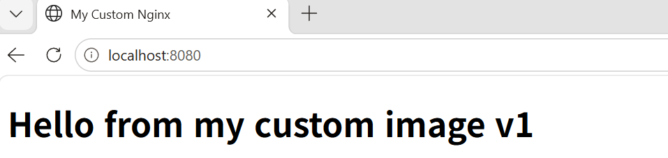
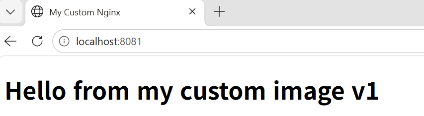
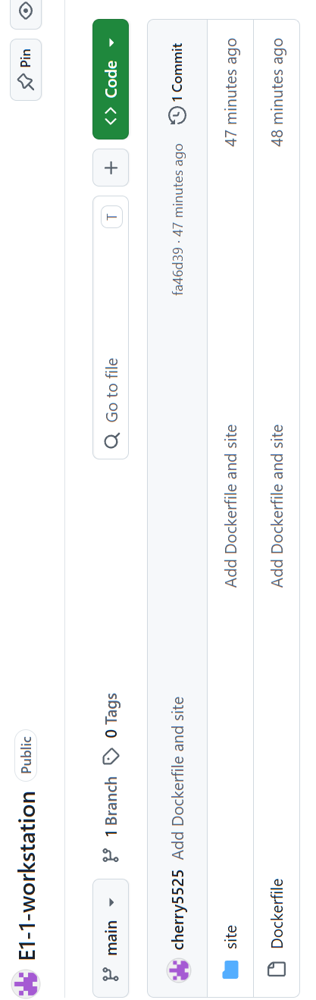
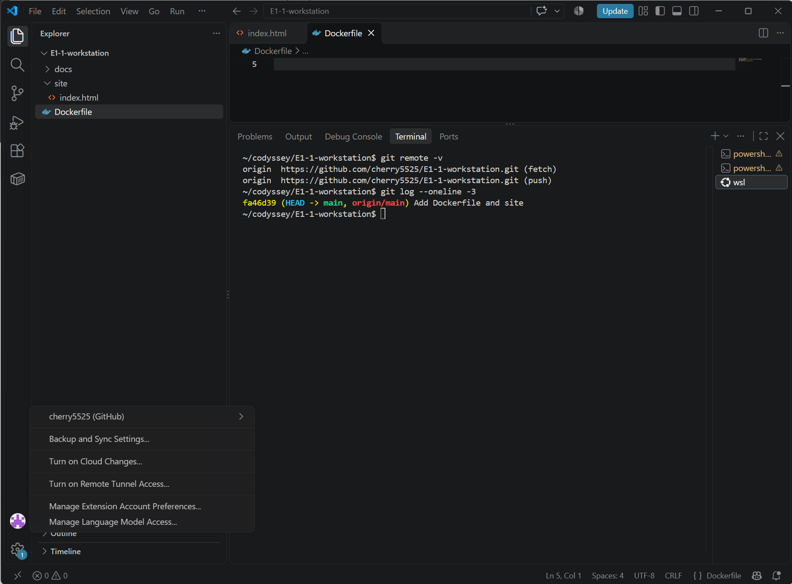

# E1-1 내 컴퓨터에 개발자용 '작업실' 꾸미기

## 1) 프로젝트 개요

터미널(리눅스 CLI), Docker, Git/GitHub를 직접 세팅하고, 실행 결과(로그/접속/데이터 유지)로 동작을 검증한 개발 워크스테이션 구축 기록입니다.

- 터미널로 작업 디렉토리와 파일 권한을 다룹니다.
- Docker를 설치/점검하고 컨테이너를 실행/관리합니다.
- Dockerfile로 nginx 기반 커스텀 이미지를 만들고, 포트 매핑·바인드 마운트·볼륨을 검증합니다.
- Git 설정 후 GitHub 저장소에 연동합니다.

> 표기 안내: 개인정보 보호를 위해 로그의 리눅스 사용자 이름은 `<user>`, 컴퓨터 이름은 `<host>`, Windows 사용자 이름은 `<winuser>`, 이메일은 `****@users.noreply.github.com`으로 마스킹했습니다. GitHub 아이디(`cherry5525`)는 저장소 주소에 공개되는 정보라 그대로 표기했습니다.

## 2) 실행 환경

| 항목 | 값 |
|---|---|
| Host OS | Windows 11 + WSL2 |
| WSL 배포판 | Ubuntu 26.04.1 LTS |
| Shell | /bin/bash |
| Docker | 29.9.2 (Docker Desktop, WSL 2 backend) |
| Git | 2.53.0 |
| 편집기 | VSCode (WSL 확장) |

```bash
$ cat /etc/os-release | head -3
PRETTY_NAME="Ubuntu 26.04.1 LTS"
NAME="Ubuntu"
VERSION_ID="26.04"
$ echo $SHELL
/bin/bash
$ docker --version
Docker version 29.9.2, build a82e528
$ git --version
git version 2.53.0
```

## 3) 수행 체크리스트

- [x] 터미널 기본 조작 (위치/목록/이동/생성/복사/이동·이름변경/삭제/내용 확인)
- [x] 권한 변경 실습 (파일 1개, 디렉토리 1개, 변경 전/후 비교)
- [x] Docker 설치/점검 (`docker --version`, `docker info`)
- [x] Docker 기본 운영 (`images`, `ps`, `ps -a`, `logs`, `stats`)
- [x] hello-world, ubuntu 컨테이너 실행
- [x] 종료/유지 차이 관찰 (`run -it`, `exec`, `attach`)
- [x] Dockerfile 기반 커스텀 이미지 빌드/실행
- [x] 포트 매핑 접속 2회 (8080, 8081)
- [x] 바인드 마운트 반영
- [x] Docker 볼륨 영속성
- [x] Git 사용자 정보/기본 브랜치 설정
- [x] GitHub 저장소 연동 (push 성공)
- [x] VSCode GitHub 로그인 및 저장소 연동 (4-10 참고)

## 4) 수행 로그 및 검증

### 4-1. 터미널 조작

작업 폴더: `~/codyssey/E1-1practice`

```bash
$ pwd
/home/<user>
$ mkdir -p ~/codyssey/E1-1practice
$ cd ~/codyssey/E1-1practice
$ touch empty.txt
$ echo "hello terminal" > note.txt
$ cat note.txt
hello terminal
$ cp note.txt note_copy.txt
$ mv note_copy.txt renamed.txt
$ mkdir backup
$ mv renamed.txt backup/
$ ls -la backup
total 12
drwxr-xr-x 2 <user> <user> 4096 Nov  3 20:35 .
drwxr-xr-x 3 <user> <user> 4096 Nov  3 20:35 ..
-rw-r--r-- 1 <user> <user>   15 Nov  3 20:34 renamed.txt
$ rm empty.txt
$ rm -r backup
$ ls -la
total 12
drwxr-xr-x 2 <user> <user> 4096 Nov  3 20:35 .
drwxr-xr-x 3 <user> <user> 4096 Nov  3 20:34 ..
-rw-r--r-- 1 <user> <user>   15 Nov  3 20:34 note.txt
```

- 확인한 것: 생성(`touch`, `mkdir`, `echo >`), 복사(`cp`), 이동/이름변경(`mv`), 삭제(`rm`, `rm -r`), 숨김 파일 포함 목록(`ls -la`), 내용 확인(`cat`).
- 홈 디렉토리 `ls -la`에는 Windows 사용자 경로가 포함된 심볼릭 링크 줄이 있어 개인정보 보호를 위해 생략했습니다.

### 4-2. 권한 실습

```bash
$ touch perm_test.txt
$ mkdir perm_dir
$ ls -l perm_test.txt
-rw-r--r-- 1 <user> <user> 0 Nov  3 20:40 perm_test.txt
$ ls -ld perm_dir
drwxr-xr-x 2 <user> <user> 4096 Nov  3 20:40 perm_dir

$ chmod 600 perm_test.txt
$ chmod 700 perm_dir
$ ls -l perm_test.txt
-rw------- 1 <user> <user> 0 Nov  3 20:40 perm_test.txt
$ ls -ld perm_dir
drwx------ 2 <user> <user> 4096 Nov  3 20:40 perm_dir

$ chmod 644 perm_test.txt
$ chmod 755 perm_dir
$ ls -l perm_test.txt
-rw-r--r-- 1 <user> <user> 0 Nov  3 20:40 perm_test.txt
$ ls -ld perm_dir
drwxr-xr-x 2 <user> <user> 4096 Nov  3 20:40 perm_dir

$ chmod 000 perm_test.txt
$ cat perm_test.txt
cat: perm_test.txt: Permission denied
$ chmod 644 perm_test.txt
$ cat perm_test.txt
$
```

| 시점 | 파일 | 디렉토리 |
|---|---|---|
| 변경 전 | `-rw-r--r--` (644) | `drwxr-xr-x` (755) |
| 600 / 700 | `-rw-------` | `drwx------` |
| 644 / 755 원복 | `-rw-r--r--` | `drwxr-xr-x` |

`chmod 000` 상태에서 `cat`이 `Permission denied`로 실패하고, 644로 되돌린 뒤 정상 동작하는 것으로 권한이 실제로 적용됨을 확인했습니다.

### 4-3. Docker 설치 및 기본 점검

```bash
$ docker --version
Docker version 29.9.2, build a82e528
$ docker info
...
Server:
 Containers: 1
  Running: 0
  Paused: 0
  Stopped: 1
 Images: 1
 Server Version: 29.9.2
 Storage Driver: overlayfs
 Cgroup Version: 2
 Kernel Version: 6.18.54.1-microsoft-standard-WSL2
 Operating System: Docker Desktop
 OSType: linux
 Architecture: x86_64
 CPUs: 24
 Total Memory: 15.25GiB
...
```

`Server:` 항목이 정상 출력되어 Docker 데몬이 동작함을 확인했습니다. (Client 플러그인 목록은 길어서 생략)

### 4-4. 컨테이너 실행 실습

```bash
$ docker run hello-world

Hello from Docker!
This message shows that your installation appears to be working correctly.

To generate this message, Docker took the following steps:
 1. The Docker client contacted the Docker daemon.
 2. The Docker daemon pulled the "hello-world" image from the Docker Hub.
    (amd64)
 3. The Docker daemon created a new container from that image which runs the
    executable that produces the output you are currently reading.
 4. The Docker daemon streamed that output to the Docker client, which sent it
    to your terminal.

To try something more ambitious, you can run an Ubuntu container with:
 $ docker run -it ubuntu bash

Share images, automate workflows, and more with a free Docker ID:
 https://hub.docker.com/

For more help on how to use Docker, go to:
 https://docs.docker.com/get-started/

$ docker run -it --name ubuntu-test ubuntu bash
root@<container-id>:/# ls
bin  boot  dev  etc  home  lib  lib32  lib64  libx32  media  mnt  opt  proc  root  run  sbin  srv  sys  tmp  usr  var
root@<container-id>:/# echo "inside container"
inside container
root@<container-id>:/# exit
```

### 4-5. 종료/유지 차이 관찰 (exec / attach)

```bash
$ docker run -dit --name ubuntu-bg ubuntu sleep infinity
$ docker ps
CONTAINER ID   IMAGE    COMMAND            CREATED          STATUS          NAMES
a944dd33b9c0   ubuntu   "sleep infinity"   About a minute   Up About a minute   ubuntu-bg

$ docker exec -it ubuntu-bg bash
root@a944dd33b9c0:/# exit

$ docker attach ubuntu-bg
(Ctrl+P, Ctrl+Q 입력)
read escape sequence
$ docker ps
CONTAINER ID   IMAGE    COMMAND            CREATED     STATUS       NAMES
a944dd33b9c0   ubuntu   "sleep infinity"   2 minutes ago   Up 2 minutes   ubuntu-bg
```

```bash
$ docker logs ubuntu-bg
(출력 없음: sleep은 로그를 내지 않음)
$ docker stats --no-stream
CONTAINER ID   NAME        CPU %   MEM USAGE / LIMIT     MEM %   NET I/O         BLOCK I/O     PIDS
a944dd33b9c0   ubuntu-bg   0.00%   3.941MiB / 15.25GiB   0.03%   1.17kB / 126B   0B / 4.1kB    1
$ docker stop ubuntu-bg
ubuntu-bg
$ docker ps -a
CONTAINER ID   IMAGE         COMMAND            STATUS                      NAMES
a944dd33b9c0   ubuntu        "sleep infinity"   Exited (137) 6 seconds ago  ubuntu-bg
d24c363ce574   ubuntu        "bash"             Exited (0) 13 minutes ago   ubuntu-test
9c742b0f81c5   hello-world   "/hello"           Exited (0) 21 minutes ago   wizardly_perlman
c7168dd9950b   hello-world   "/hello"           Exited (0) 2 hours ago      focused_ishizaka
```

**관찰 정리**

| 방식 | 동작 | 결과 |
|---|---|---|
| `docker run -it ... bash` 후 `exit` | 메인 프로세스(bash)가 종료됨 | 컨테이너도 종료 (`Exited (0)`) |
| `docker exec -it ... bash` 후 `exit` | 새로 만든 프로세스만 종료됨. 메인 프로세스(`sleep`)는 그대로 | 컨테이너 유지 (`Up`) |
| `docker attach` | 메인 프로세스에 직접 연결됨 | `-it`로 만든 컨테이너는 Ctrl+P, Ctrl+Q로 분리해 유지 가능 |

`docker stop` 후 `Exited (137)`은 SIGKILL(128+9=137)로 강제 종료되었음을 의미합니다. SIGTERM 무시 여부는 이 로그만으로 확정할 수 없으며, `docker stop`의 기본 대기 시간(10초) 안에 프로세스가 종료되지 않아 SIGKILL이 발송된 것으로 추정됩니다.

### 4-6. Dockerfile 기반 커스텀 이미지 (방식 A: nginx)

**선택한 베이스**: `nginx:alpine` (공식 웹 서버 이미지) + 정적 콘텐츠 교체

**프로젝트 구조**

```
e1-1-workstation/
├── Dockerfile
├── site/
│   └── index.html
├── docs/images/
└── README.md
```

**site/index.html**

```html
<!DOCTYPE html>
<html lang="ko">
<head><meta charset="UTF-8"><title>My Custom Nginx</title></head>
<body>
  <h1>Hello from my custom image v1</h1>
</body>
</html>
```

**Dockerfile**

```dockerfile
FROM nginx:alpine
LABEL org.opencontainers.image.title="my-custom-nginx"
ENV APP_ENV=dev
COPY site/ /usr/share/nginx/html/
```

| 커스텀 포인트 | 목적 |
|---|---|
| `FROM nginx:alpine` | 검증된 기존 웹 서버 이미지를 베이스로 사용 (가볍고 바로 서비스 가능) |
| `LABEL` | 이미지 이름 등 메타데이터를 기록 |
| `ENV APP_ENV=dev` | 실행 환경 설정을 코드와 분리해 환경 변수로 주입 |
| `COPY site/ ...` | nginx 기본 페이지를 내 정적 콘텐츠로 교체 |

**빌드 및 실행 (포트 매핑 2회)**

```bash
$ docker build -t my-web:1.0 .
$ docker run -d -p 8080:80 --name my-web-8080 my-web:1.0
$ docker run -d -p 8081:80 --name my-web-8081 my-web:1.0
$ docker ps
CONTAINER ID   IMAGE        COMMAND                  STATUS         PORTS                                          NAMES
79e61abff467   my-web:1.0   "/docker-entrypoint.…"   Up 2 minutes   0.0.0.0:8081->80/tcp, [::]:8081->80/tcp   my-web-8081
56d7cf2d45a0   my-web:1.0   "/docker-entrypoint.…"   Up 2 minutes   0.0.0.0:8080->80/tcp, [::]:8080->80/tcp   my-web-8080

$ curl http://localhost:8080
<!DOCTYPE html>
<html lang="ko">
<head><meta charset="UTF-8"><title>My Custom Nginx</title></head>
<body>
  <h1>Hello from my custom image v1</h1>
</body>
</html>
$ curl http://localhost:8081
(위와 동일한 응답)

$ docker images
IMAGE                ID             DISK USAGE   CONTENT SIZE
hello-world:latest   c567b231f656   25.9kB       9.49kB
my-web:1.0           b6ae447e537f   93.6MB       26.3MB
ubuntu:latest        6a06111c3b0a   163MB        45.9MB
```

**브라우저 접속 증거 (주소창 + 응답 화면)**




**포트 매핑이 필요한 이유**: 컨테이너는 격리된 네트워크 안에서 실행되므로 컨테이너 내부 포트(80)에 호스트에서 바로 접근할 수 없습니다. `-p 호스트포트:컨테이너포트`로 연결해야 호스트의 `localhost:8080`으로 들어온 요청이 컨테이너의 80번 포트로 전달됩니다. 같은 이미지를 두 번 실행하면 호스트 포트만 달리해(8080, 8081) 동시에 접근할 수 있습니다.

**이미지와 컨테이너**: 이미지(`my-web:1.0`)는 변하지 않는 설계도이고, 컨테이너는 그 이미지로 실행한 인스턴스입니다. 이미지 하나로 컨테이너 두 개를 띄운 것이 위 결과입니다.

### 4-7. 바인드 마운트 (호스트 변경 즉시 반영)

```bash
$ docker run -d -p 8082:80 --name bind-test -v "$(pwd)/site:/usr/share/nginx/html" nginx:alpine
$ curl http://localhost:8082
(변경 전) ... <h1>Hello from my custom image v1</h1> ...

$ sed -i 's/Hello from my custom image v1/Hello v2 (bind mount)/' site/index.html
$ cat site/index.html
<!DOCTYPE html>
<html lang="ko">
<head><meta charset="UTF-8"><title>My Custom Nginx</title></head>
<body>
  <h1>Hello v2 (bind mount)</h1>
</body>
</html>

$ curl http://localhost:8082
... <h1>Hello v2 (bind mount)</h1> ...        # 재빌드 없이 즉시 반영
$ curl http://localhost:8080
... <h1>Hello from my custom image v1</h1> ... # COPY로 구워진 이미지는 그대로 v1
```

- 바인드 마운트: 호스트 폴더를 컨테이너와 실시간 공유합니다. 호스트에서 고치면 바로 반영됩니다.
- `COPY`: 빌드 시점의 내용이 이미지에 고정됩니다. 바꾸려면 이미지를 다시 빌드해야 합니다.

> **현재 파일 상태**: 이 실습 후 `site/index.html`은 v2(`Hello v2 (bind mount)`) 상태입니다. `my-web:1.0` 이미지는 빌드 당시 v1이 복사된 상태로 고정되어 있으며, 현재 파일과 무관합니다. 재현 시 `docker build`를 다시 실행하면 현재 v2 내용이 이미지에 들어갑니다.

### 4-8. Docker 볼륨 영속성

```bash
$ docker volume create mydata
mydata
$ docker volume ls
DRIVER    VOLUME NAME
local     mydata

$ docker run -d --name vol-test -v mydata:/data ubuntu sleep infinity
$ docker exec vol-test bash -c "echo hi > /data/hello.txt && cat /data/hello.txt"
hi

$ docker rm -f vol-test
vol-test
$ docker ps -a          # vol-test가 목록에 없음을 확인

$ docker run -d --name vol-test2 -v mydata:/data ubuntu sleep infinity
$ docker exec vol-test2 bash -c "cat /data/hello.txt"
hi                      # 컨테이너를 삭제했는데도 데이터가 남아 있음

$ docker volume inspect mydata
[
    {
        "CreatedAt": "2026-11-03T12:51:48Z",
        "Driver": "local",
        "Labels": null,
        "Mountpoint": "/var/lib/docker/volumes/mydata/_data",
        "Name": "mydata",
        "Options": null,
        "Scope": "local"
    }
]
```

컨테이너의 파일시스템은 컨테이너와 함께 사라지지만, 볼륨은 Docker가 컨테이너와 별도로 관리하므로 컨테이너를 삭제해도 데이터가 유지됩니다.

### 4-9. 정리

```bash
$ docker rm -f vol-test2 bind-test my-web-8080 my-web-8081
$ docker ps -a
CONTAINER ID   IMAGE         COMMAND    STATUS                      NAMES
9c742b0f81c5   hello-world   "/hello"   Exited (0) 48 minutes ago   wizardly_perlman
c7168dd9950b   hello-world   "/hello"   Exited (0) 2 hours ago      focused_ishizaka
```

### 4-10. Git 설정 및 GitHub 연동

```bash
$ git config --global user.name "cherry5525"
$ git config --global user.email "****@users.noreply.github.com"
$ git config --global init.defaultBranch main
$ git config --list
user.name=cherry5525
user.email=****@users.noreply.github.com
init.defaultbranch=main
```

> 이메일은 GitHub의 noreply 주소를 사용해 커밋 기록에 실제 이메일이 노출되지 않게 했습니다.

```bash
$ git init
$ git status
On branch main
No commits yet
Untracked files:
        Dockerfile
        site/
$ git add .
$ git commit -m "Add Dockerfile and site"
$ git remote add origin https://github.com/cherry5525/E1-1-workstation.git
$ git push -u origin main
```

GitHub 저장소에 `Dockerfile`, `site/`가 올라간 화면:



**VSCode 연동 증거**

VSCode(WSL 터미널 사용)에서 GitHub 계정 로그인 상태와 저장소 연동을 확인했습니다. VSCode 터미널에서 실행한 결과입니다.

```bash
~/codyssey/E1-1-workstation$ git remote -v
origin  https://github.com/cherry5525/E1-1-workstation.git (fetch)
origin  https://github.com/cherry5525/E1-1-workstation.git (push)
~/codyssey/E1-1-workstation$ git log --oneline -3
fa46d39 (HEAD -> main, origin/main) Add Dockerfile and site
```



- 계정 메뉴에 `cherry5525 (GitHub)`가 표시되어 VSCode에 GitHub 로그인이 되어 있습니다.
- 탐색기에 `Dockerfile`, `site/`가 열려 있고, 터미널 탭은 `wsl` 프로필입니다.
- `HEAD -> main, origin/main`이 같은 커밋(`fa46d39`)을 가리켜 로컬과 GitHub가 동기화되어 있습니다.

## 5) 트러블슈팅

### 5-1. docker.sock 권한 오류

| 항목 | 내용 |
|---|---|
| 문제 | `docker info` 실행 시 `permission denied while trying to connect to the docker API at unix:///var/run/docker.sock` |
| 원인 가설 | 현재 리눅스 계정이 `docker` 그룹에 속하지 않아 소켓 접근 권한이 없다 |
| 확인 | `groups` 출력에 `docker`가 없었음 |
| 해결 | `sudo usermod -aG docker $USER` 실행 후 PowerShell에서 `wsl --shutdown`으로 재시작. 이후 `groups`에 `docker`가 표시되고 `docker info`의 Server 항목이 정상 출력됨 |

### 5-2. attach 후 빠져나오지 못함

| 항목 | 내용 |
|---|---|
| 문제 | `docker attach` 후 Ctrl+P/Q, `--detach-keys="ctrl-x"`가 동작하지 않았고, 창을 닫자 컨테이너가 `Exited (137)`로 종료됨 |
| 원인 가설 | (1차) Windows 터미널의 분리 키 처리 문제 → (2차) 컨테이너를 `-it` 없이 만들어 키 입력이 전달되지 않음 |
| 확인 | 입력한 키가 `^X`, `^P` 글자로만 화면에 출력됨. 컨테이너를 `docker run -d`로만 만들었음 |
| 해결 | 컨테이너를 삭제하고 `docker run -dit`로 재생성. 이후 Ctrl+P, Ctrl+Q로 `read escape sequence`와 함께 분리되었고 컨테이너는 `Up` 유지 |

### 5-3. 컨테이너 안에서 docker 명령 실행

| 항목 | 내용 |
|---|---|
| 문제 | `docker exec -it ... bash` 후 `docker ps` 입력 시 `bash: docker: command not found` |
| 원인 가설 | docker CLI가 컨테이너 안에 없거나, 호스트가 아닌 컨테이너 안에서 입력했다 |
| 확인 | 프롬프트가 `root@<컨테이너ID>:/#`로 바뀌어 있었음 |
| 해결 | `exit`로 호스트에 돌아와 같은 명령을 실행 |

### 5-4. PowerShell에서 curl 보안 경고

| 항목 | 내용 |
|---|---|
| 문제 | `curl http://localhost:8080` 실행 시 "보안 경고: 스크립트 실행 위험" 및 `WebCmdletIEParsingDeclined` 오류 |
| 원인 가설 | Ubuntu가 아닌 PowerShell에서 실행해 `curl`이 `Invoke-WebRequest` 별칭으로 동작 |
| 확인 | 프롬프트가 `PS ...>`로 시작함 |
| 해결 | 경고에 N 입력 후 Ubuntu 터미널에서 재실행해 정상 응답 확인 (PowerShell에서는 `curl.exe` 사용 가능) |

### 5-5. git push 비밀번호 인증 실패

| 항목 | 내용 |
|---|---|
| 문제 | `git push` 시 `Password authentication is not supported for Git operations`, `fatal: Authentication failed` |
| 원인 가설 | GitHub가 Git 작업의 비밀번호 인증을 지원하지 않고, WSL에 인증 수단이 연결되어 있지 않다 |
| 확인 | 비밀번호를 물은 뒤 인증 거부 메시지가 출력됨 |
| 해결 | `gh` 설치 후 `gh auth login`으로 브라우저 인증 → `git push -u origin main` 성공 |

### 5-6. gh 로그인 시 브라우저 자동 실행 실패

| 항목 | 내용 |
|---|---|
| 문제 | `gh auth login` 중 `Failed opening a web browser ... executable file not found in $PATH` |
| 원인 가설 | WSL에 브라우저를 여는 도구(xdg-open 등)가 없다 |
| 확인 | 오류 메시지가 수동 입력을 안내함 |
| 해결 | Windows 브라우저에서 `https://github.com/login/device`를 직접 열고 일회용 코드를 입력해 인증 완료 |

### 5-7. VSCode가 응답하지 않음

| 항목 | 내용 |
|---|---|
| 문제 | `code .` 실행 시 "Another instance of Code is running but not responding", `wsl.localhost` 허용 여부 확인창 |
| 원인 가설 | 기존 VSCode 프로세스가 응답 없이 남아 있음. `wsl.localhost`는 WSL 파일을 여는 공식 주소 |
| 확인 | 경로가 내가 연 WSL 프로젝트 폴더임을 확인 |
| 해결 | 확인창에서 Allow 선택, 필요 시 작업 관리자에서 Code 프로세스를 종료한 뒤 `code .` 재실행 |

## 6) 개념 정리

**절대 경로와 상대 경로**
- 절대 경로: 루트(`/`)부터 시작하는 전체 경로. 현재 위치와 무관. 예) `/home/<user>/codyssey/E1-1practice/note.txt`
- 상대 경로: 현재 위치 기준. 예) `./note.txt`, `../E1-1practice/note.txt`
- 현재 위치가 `~/codyssey/E1-1practice`일 때 `cat note.txt`와 절대 경로로 읽는 것은 같은 파일을 가리킵니다.

**파일 권한 (r/w/x, 755, 644)**
- `ls -l` 표기: `[종류][소유자][그룹][기타]` 순서. 예) `-rw-r--r--`는 파일, 소유자 rw-, 그룹 r--, 기타 r--
- r=4, w=2, x=1이고 합산해 숫자로 표기: 7=rwx, 6=rw-, 5=r-x, 4=r--
- `755` = 소유자 rwx / 그룹 r-x / 기타 r-x (실행 파일, 디렉토리에 흔함)
- `644` = 소유자 rw- / 그룹 r-- / 기타 r-- (일반 파일에 흔함)
- 디렉토리의 x는 "그 안으로 들어갈 수 있는 권한"입니다.

**Docker 볼륨**: 컨테이너와 별도로 Docker가 관리하는 저장소입니다. 컨테이너를 삭제해도 데이터가 남아 영속 데이터(DB 등)에 사용합니다. (4-8 참고)

**Git과 GitHub의 차이**: Git은 내 컴퓨터에서 변경 이력을 관리하는 로컬 버전 관리 도구이고, GitHub는 Git 저장소를 원격에 올려 공유/협업하는 플랫폼입니다.

## 7) 재현 방법

```bash
git clone https://github.com/cherry5525/E1-1-workstation.git
cd E1-1-workstation
docker build -t my-web:1.0 .
docker run -d -p 8080:80 --name my-web-8080 my-web:1.0
curl http://localhost:8080
```

- 경로(`/home/<user>`, `~/codyssey/...`)는 개인 환경에 맞게 바꿔 사용합니다.
- Windows에서는 Docker Desktop(WSL 2) + Ubuntu(WSL) 환경에서 실행합니다. 작업 폴더는 `/mnt/c`가 아닌 리눅스 홈 아래에 두어야 권한 실습과 바인드 마운트가 정상 동작합니다.
- 포트(8080 등)가 이미 사용 중이면 다른 호스트 포트를 사용합니다.
